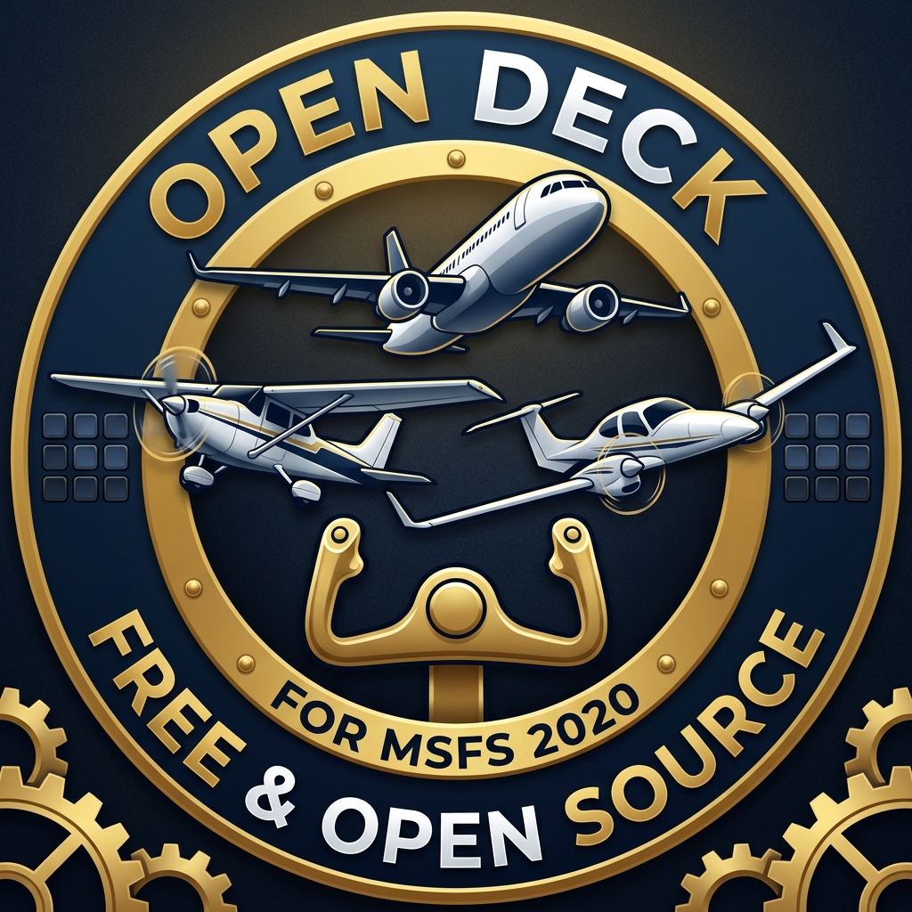
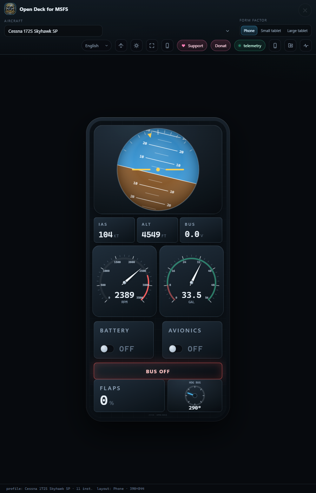
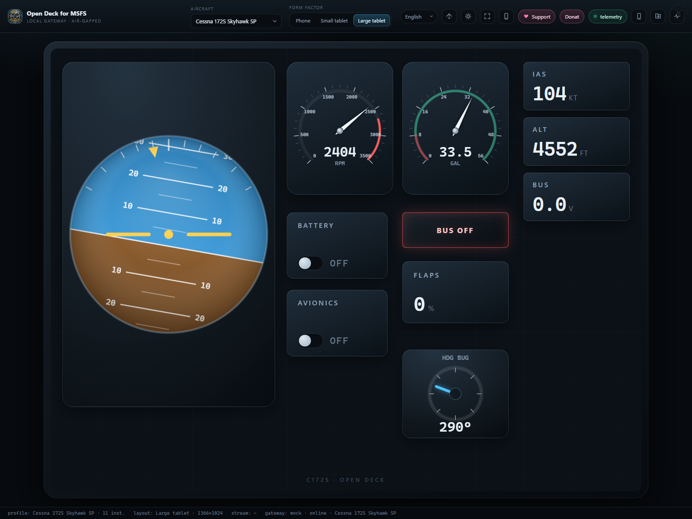
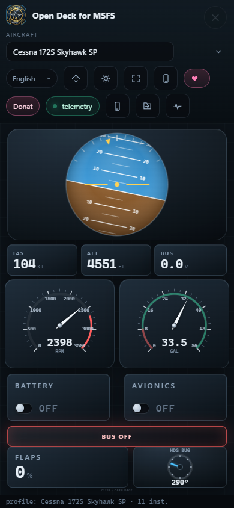
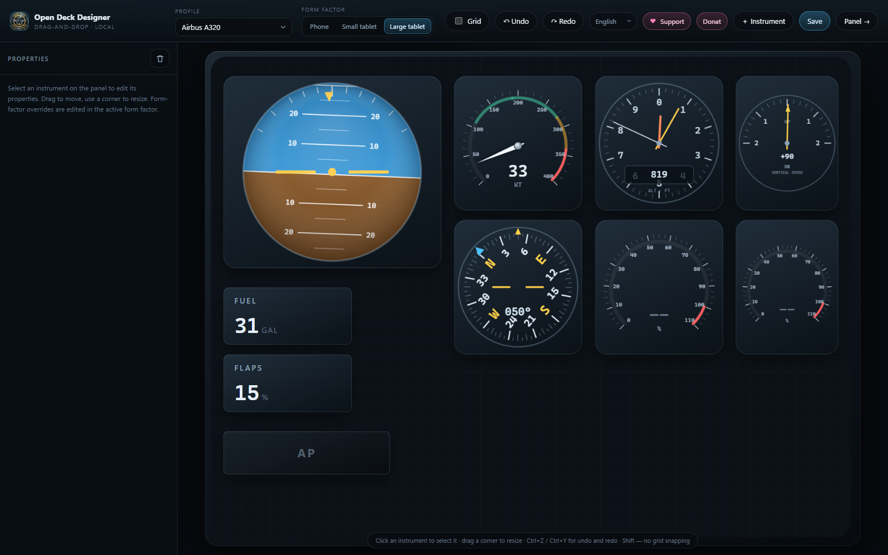
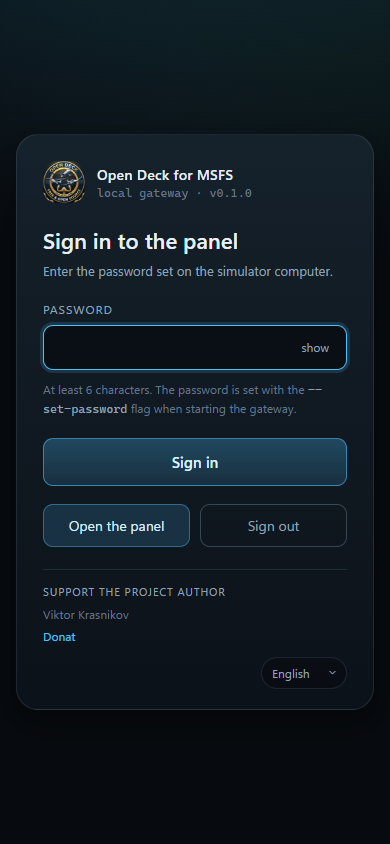
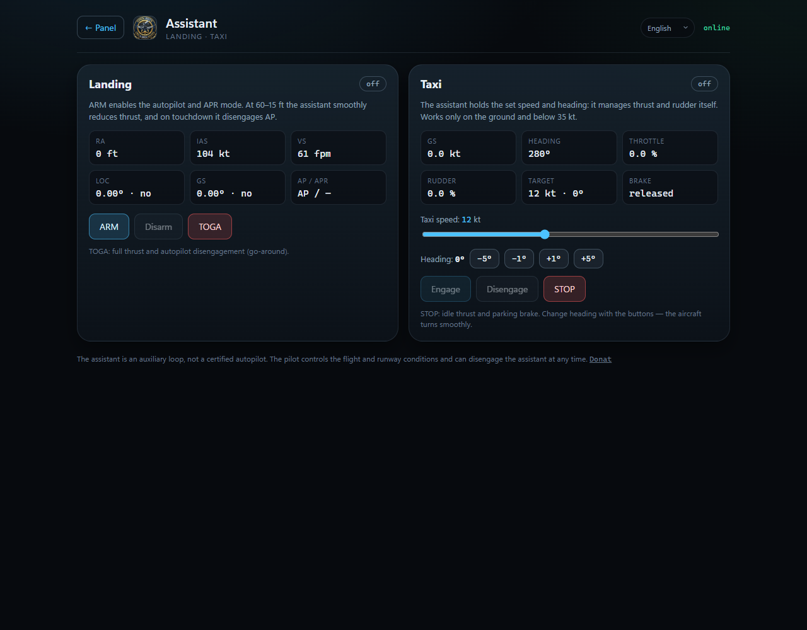

# ✈️ Open Deck for MSFS

**Languages:** [English](README.md) · [Русский](README_RU.md) · [Deutsch](README_DE.md) · [中文](README_ZH.md) · [Español](README_ES.md) · [日本語](README_JA.md)




**MSFS 2020/2024 instrument panels on your phone and tablet — over the local
network, without internet.**

A Windows gateway reads telemetry from Microsoft Flight Simulator through
SimConnect (including LVAR/RPN through a WASM module) and serves it to web
clients and an Android app over HTTP + WebSocket. Panels are described by
aircraft JSON profiles and rendered for three form factors.

The project is fully self-contained: **no external CDN, font, or service** —
everything works on an isolated network and on a machine without internet
access.

| | |
| --- | --- |
| Version | 0.1.0 |
| Tests | 248 Python + 35 Node.js |
| Host platform | Windows 10/11 (Python 3.11+ or installer) |
| Clients | browser (any modern one), Android 8+ |
| Author | Viktor Krasnikov — [github.com/meferspb/open-deck](https://github.com/meferspb/open-deck) |
| Donat | [https://taps.uz/open_deck_fs](https://taps.uz/open_deck_fs) |
| License | [GNU AGPL-3.0](LICENSE) — free software with a mandatory author support block (Section 7) |

## Screenshots

| Phone | Large tablet |
| --- | --- |
|  |  |

| Classic C172 six-pack | Panel editor |
| --- | --- |
|  |  |





## Features

### Gateway

- **One port** for static files, REST, and WebSocket — a single firewall rule is
  enough; Python standard library only, no `pip install`.
- **Swappable telemetry source**:
  - `simconnect` — native SimConnect through `ctypes`;
  - `mock` — a procedural "flight" without the simulator (demo and tests);
  - `auto` — SimConnect, falling back to mock on failure.
- **Aircraft autodetection**: the profile declares `sim.match.title` and
  `atcModel`, the gateway reads `TITLE`/`ATC MODEL` and switches the panel
  automatically.
- **LVAR/RPN through WASM** (MobiFlight/SimBridge): Client Data Area,
  a synchronous channel with timeouts, LVAR writes through RPN.
- **Host autodiscovery** via UDP beacon (for native clients), a built-in
  HTTP server, JSON API, and strict validation of profiles and commands.

### Profiles and instruments

- **6 profiles**: Cessna 172S, Cessna 172 Classic Six-Pack, Daher TBM 930,
  Airbus A320, Piper PA-28-181, LVAR demo.
- **Instruments**: attitude indicator, circular gauges, digital readouts,
  toggle switches, rotary selector (gestures/wheel), annunciator lights, VSI,
  three-pointer altimeter, heading indicator with a "bug".
- Layout in panel fractions + overrides `layout.phone`,
  `layout.tablet-sm`, `layout.tablet-lg`; schema and validation —
  [`docs/profile-schema.md`](docs/profile-schema.md).

### Clients

- **Web client** on vanilla ES modules: smooth animation (rAF), smoothing,
  gestures, command widgets, reconnection.
- **Three form factors** with automatic selection by screen width.
- **Cockpit comfort**: panel brightness 100/72/45 % (key `B`) and a kiosk mode
  without UI (`F`, exit with `Esc`).
- **Phone connection by QR**: the panel page shows a QR code for the host
  address and a list of network addresses.
- **Android client**: WebView panel, UDP host discovery, integrity checking,
  a connection screen with manual address entry.

### Security

- **Password login** (at least 6 characters): PBKDF2 hash, sessions in an
  `HttpOnly` cookie, Bearer tokens for native clients, attempt limiting, QR
  login from a phone without entering a password. A one-time QR token is valid
  only through `/?pair=` and is not accepted as a regular session.
- **Same-origin and Host protection**: browser POST/PUT and WebSocket requests
  with a foreign `Origin`, as well as requests with an unknown `Host`, are
  rejected (`403`). This closes CSRF, cross-site WebSocket hijacking, and DNS
  rebinding; clients without `Origin` (Android, curl) work as before.
- Only the login page, health/integrity checks, and the author support block
  are publicly accessible — everything else (profiles, telemetry, commands, APK
  build) is closed.

### Landing and taxi assist

- **Taxi**: holding a target speed (3–25 kt) and heading — the gateway computes
  throttle and rudder; "STOP" gives zero throttle and the parking brake.
- **Landing**: ARM enables AP and APR, at 60–15 ft the assist smoothly reduces
  throttle, and on touchdown it disengages the autopilot; TOGA — go-around.
- Page `/assist.html` (the "Assist" button in the panel header); it also works
  on a phone. The assist is an auxiliary loop; the pilot remains in control of
  the flight.

### Tools

- **Panel editor** `/editor.html`: drag-and-drop, resizing,
  1 % grid snapping, undo/redo (`Ctrl+Z` / `Ctrl+Y`), copying
  layouts between form factors, saving the profile to the host.
- **Android APK builder** right in the distribution: page `/android.html`
  changes the app name, package id, version, and gateway address, builds the
  APK, and offers it for download; there is also a CLI `--build-apk`.
- **Windows installer** (NSIS, per-user, no administrator rights) with a
  ready-made APK and Android sources inside.

### License and integrity

- The author support block **cannot be removed**; SHA-256 of critical files is
  verified at host startup and in the browser, and on mismatch the UI is
  blocked.

## Installation (Windows, no Python)

Download `OpenDeck-Setup-<version>.exe` from the releases, run it, and click
"Next" — administrator rights are not required, and neither Python nor the
internet is needed. Installation goes to `%LOCALAPPDATA%\OpenDeck`, shortcuts
and an entry in "Programs and Features" are created.

1. Launch **Open Deck for MSFS** — a console with the panel addresses opens.
2. Allow the app access to the private network in the firewall prompt.
3. Open the panel on this PC or enter the printed address on your phone,
   or scan the QR from the panel (the phone button).

Installer build details — [`packaging/windows/README.md`](packaging/windows/README.md).

## Password login

Login is enabled in one of the following ways:

```powershell
# save the password (PBKDF2 hash) to config/auth.json
OpenDeck.exe --set-password            # prompts for the password in the console
OpenDeck.exe --set-password "my-password"

# or for this run only
OpenDeck.exe --password "my-password"
```

Minimum **6 characters**. The file `config/auth.json` stores only the hash;
delete it to allow access without a password again. In the Start menu the
installer creates a "Set password" shortcut. Details — in the
[service description](docs/service.md#8-password-authentication).

Connected clients:

- browser — page `/login.html`, then the panel (cookie for 12 hours);
- phone — scan the QR on the panel: a one-time token logs in without a password
  (valid for 10 minutes);
- Android — the panel shows the login screen itself; the session is stored in
  the WebView.

## Running from source

**Python 3.11+** is required; Node.js — only for client tests.

```powershell
git clone https://github.com/meferspb/open-deck.git
cd open-deck

# demo mode without the simulator: http://127.0.0.1:8760/
python -m msfs_gateway --sim mock

# real flight: SimConnect, falling back to mock on failure
python -m msfs_gateway --sim auto

# explicit DLL path and 60 Hz
python -m msfs_gateway --sim simconnect --simconnect-dll C:\SDK\SimConnect.dll --telemetry-hz 60
```

Useful parameters:

| Parameter | Default | Purpose |
| --- | --- | --- |
| `--host` | `0.0.0.0` | listen address |
| `--allow-host NAME` | — | additional DNS name for the Host header (repeatable) |
| `--port` | `8760` | HTTP and WebSocket port |
| `--sim` | `auto` | `auto` / `mock` / `simconnect` |
| `--telemetry-hz` | `30` | broadcast rate, 1..60 Hz |
| `--simconnect-host` / `--simconnect-port` | `127.0.0.1` / `19999` | SimConnect address (including a remote simulator) |
| `--profile-dir` | `profiles/` | JSON profile directory |
| `--password` / `--set-password` | — | password for the run / save the hash and exit |
| `--auth-file` / `--no-auth` | `config/auth.json` | hash file / disable login |
| `--no-wasm` | — | disable the WASM bridge |
| `--no-discovery` | — | disable UDP autodiscovery |
| `--build-apk [CONFIG]` | — | build the Android APK and exit |

## Android APK from the distribution

The installed app contains the Android sources (`android/`); the ready APK is
built to `android/dist/OpenDeck-Android-<version>.apk`, and the Start menu has
"Build Android APK" (`http://127.0.0.1:8760/android.html`).

On the page you set the app name, package id, version, and default gateway
address; the "Build APK" button runs `gradle assembleDebug` on the same
computer. **JDK 17**, **Android SDK**, and **Gradle 8.x** are required (paths
can be specified on the page or set through `JAVA_HOME` / `ANDROID_HOME` /
`gradle` in `PATH`). In the release distribution the ready APK is already in
`android/dist`.

```powershell
OpenDeck.exe --build-apk                        # settings from config/android-build.json
OpenDeck.exe --build-apk C:\path\settings.json
```

## Documentation

The full index is [docs/README.md](docs/README.md). Main documents:

- [Service description: purpose, API, authentication, assist, operation](docs/service.md)
- [Architecture and responsibilities](docs/architecture.md)
- [Network protocol: REST, WebSocket, login, QR, autodiscovery](docs/protocol.md)
- [Telemetry variable catalog](docs/telemetry.md) *(generated from code)*
- [Instrument and option catalog](docs/widgets.md) *(generated from code)*
- [Aircraft profile schema](docs/profile-schema.md)
- [Android client: build, login, debugging](android/README.md)
- [Building the installer](packaging/windows/README.md)
- [Cost of connected services vs local equivalents](docs/pricing.md)
- [Changelog](CHANGELOG.md)

## Repository structure

```
msfs_gateway/            # Python gateway (stdlib)
  sim/                   # providers: mock, simconnect, client_data, wasm_bridge
  qr.py                  # built-in QR generator (SVG)
  assist.py              # landing and taxi assist
  android_build.py       # APK build from the distribution
  http_api.py, hub.py, profiles.py, integrity.py, discovery.py, websocket.py
web/                     # web client and editor (vanilla JS, no build step)
profiles/                # aircraft JSON profiles
android/                 # Android client (Kotlin, no AndroidX)
packaging/               # PyInstaller + NSIS: Windows installer
scripts/                 # build-installer.ps1, check.ps1, verify_qr.py
tests/                   # unittest (Python) and node:test (JS)
docs/                    # architecture, protocol, schema, screenshots
config/                  # author details, APK build settings
integrity/               # SHA-256 manifest of critical files
```

## Tests

```powershell
python -m unittest discover -s tests        # 248 tests
node --test "tests/web/*.test.mjs"          # 29 tests
python -m ruff check msfs_gateway tests scripts
```

Run all checks at once:

```powershell
pwsh -File scripts/check.ps1
```

Covered: telemetry and profiles, WebSocket (RFC 6455), bus and commands,
mock provider, WASM/Client Data, QR (structure + reference matrix),
APK builder, integrity, instrument geometry, and layouts.

## Development

See [`CONTRIBUTING.md`](CONTRIBUTING.md): style, tests, how to add a profile
or an instrument. Security questions — [`SECURITY.md`](SECURITY.md).

## Roadmap

1. **Live run of the WASM bridge** with MSFS + MobiFlight/SimBridge (logic and
   emulation are covered by tests).
2. **Release signing of the APK**: keystore/alias in the builder settings.
3. **mDNS (Bonjour)** as an alternative to the UDP beacon.
4. **Editor**: alignment guides, multi-selection.
5. **Android**: native Compose rendering, foreground service for kiosk mode.
6. **Telemetry recording/replay** for demos and profiling.

## Security

The project is designed for a **trusted local network**: HTTP without TLS and
authentication, and an unsigned UDP beacon. Do not expose the gateway to the
internet. More — [`SECURITY.md`](SECURITY.md).

## Support / Donat

- **Donat:** [https://taps.uz/open_deck_fs](https://taps.uz/open_deck_fs)
- **Author:** Viktor Krasnikov
- **Repository:** [https://github.com/meferspb/open-deck](https://github.com/meferspb/open-deck)

## License

The project is distributed under the **GNU Affero General Public License v3.0 (AGPL-3.0)** with additional terms in accordance with **Section 7**.

* You are free to use, study, modify, and distribute this code provided that the same license (AGPL-3.0) is preserved and the source code of any modifications is made available (including use on a server / over a network according to Section 13).
* **Mandatory condition (Section 7(b) & Section 5(d)):** In all forks, builds, and modified versions it is **strictly forbidden** to remove, hide, or alter the mention of the original author (**Viktor Krasnikov**, [https://github.com/meferspb/open-deck](https://github.com/meferspb/open-deck)) and the active links to the developer's support (donation) page in the program's user interface and documentation: [Donat — https://taps.uz/open_deck_fs](https://taps.uz/open_deck_fs).

The detailed legal text of the additional terms is provided in the file [COPYING.ADDITIONAL](./COPYING.ADDITIONAL). The full text of the base license is in the file [LICENSE](./LICENSE).
